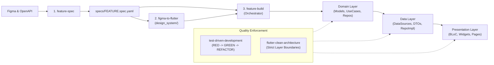

# Flutter Agent Skills 🚀

A comprehensive, production-grade suite of AI agent skills and team playbooks for Flutter development. Designed for **OpenMausBot**, **Claude Code**, **Cursor**, and **Google Antigravity / Gemini**.

These skills enforce strict Clean Architecture, design-token extraction, contract-first YAML specifications, test-driven development (TDD), and disciplined layer-by-layer implementation.

---

## 📦 What's Included

| Skill | Directory | Purpose |
|---|---|---|
| **`feature-spec`** | [`skills/feature-spec/`](skills/feature-spec/SKILL.md) | Turns Figma designs and Swagger/OpenAPI endpoints into a single approved YAML contract (`specs/<feature>.spec.yaml`). |
| **`figma-to-flutter`** | [`skills/figma-to-flutter/`](skills/figma-to-flutter/SKILL.md) | Extracts design tokens into `lib/design_system/` and generates pure, reusable widgets decoupled from state management. |
| **`flutter-clean-architecture`** | [`skills/flutter-clean-architecture/`](skills/flutter-clean-architecture/SKILL.md) | Enforces feature-first Clean Architecture, Dart 3 class modifiers, sealed BLoC/Cubit states, and functional error handling. |
| **`test-driven-development`** | [`skills/test-driven-development/`](skills/test-driven-development/SKILL.md) | Enforces the iron law of TDD: **Red-Green-Refactor** with no production code written before a failing test passes. |
| **`feature-build`** | [`skills/feature-build/`](skills/feature-build/SKILL.md) | Orchestrates feature construction layer-by-layer (`domain` → `data` → `presentation`) using fakes and verification gates. |

---

## 🤖 Importing into OpenMausBot

OpenMausBot supports two flexible ways to import these capabilities:

### Method 1: 1-Click Team Import (Recommended)

Import the entire **Flutter Engineering Squad** (Chief of Staff, Flutter Architect, Flutter Builder, and TDD Specialist) with all skills pre-wired:

1. Open **OpenMausBot**.
2. Navigate to **Teams → Import** (or click the **+** button in the team list).
3. Choose one of the following:
   - **Paste GitHub URL**:
     ```text
     https://raw.githubusercontent.com/mahmood1996/flutter-skills/main/playbooks/flutter-engineering-team.md
     ```
   - **Import File from Disk**: Select `playbooks/flutter-engineering-team.md` from your cloned repository.
4. Review the team summary card and click **Import Team**.
5. Enable the skills under each bot's **Skills** tab when you're ready to start building!

---

### Method 2: Individual Skill Import

To attach specific skills to any existing bot in OpenMausBot:

1. In OpenMausBot, open **Settings → Import** (or navigate to a bot's settings and click **Skills**).
2. Click **Add Custom Skill** or **Import Folder**.
3. Select any skill directory (e.g. `skills/flutter-clean-architecture/`) or paste the contents of its `SKILL.md`.
4. Save and toggle the skill **ON** for the bot.

---

## 🛠️ Usage with Other AI Coding Assistants

### Claude Code
Clone or copy the skills into your local Claude configuration:
```bash
# Workspace level
mkdir -p .claude/skills
cp -r skills/* .claude/skills/

# Or global user level
mkdir -p ~/.claude/skills
cp -r skills/* ~/.claude/skills/
```

### Cursor & Windsurf
Add the skills directly to your project root or rules:
- Copy the desired `SKILL.md` files into `.cursor/rules/` or your project prompt library.

### Antigravity / Gemini CLI
Copy into the agent customization skills root:
```bash
# Global
cp -r skills/* ~/.gemini/config/skills/

# Workspace
mkdir -p .agents/skills
cp -r skills/* .agents/skills/
```

---

## 🔄 End-to-End Workflow



1. **Plan & Spec**: Run `feature-spec` to normalize Figma designs and Swagger definitions into an approved contract YAML file.
2. **Tokens**: Run `figma-to-flutter` to extract tokens (`app_colors.dart`, `app_radiis.dart`, `app_spacing.dart`) and pure widgets.
3. **Build Layers**: Run `feature-build` to slice each layer, apply strict TDD cycles, verify with `flutter test`, and assemble the feature.
4. **Enforce Boundaries**: Ensure domain code never touches data sources, and presentation widgets never bypass BLoC/Cubit.

---

## 📄 License

This repository is licensed under the [MIT License](LICENSE).
