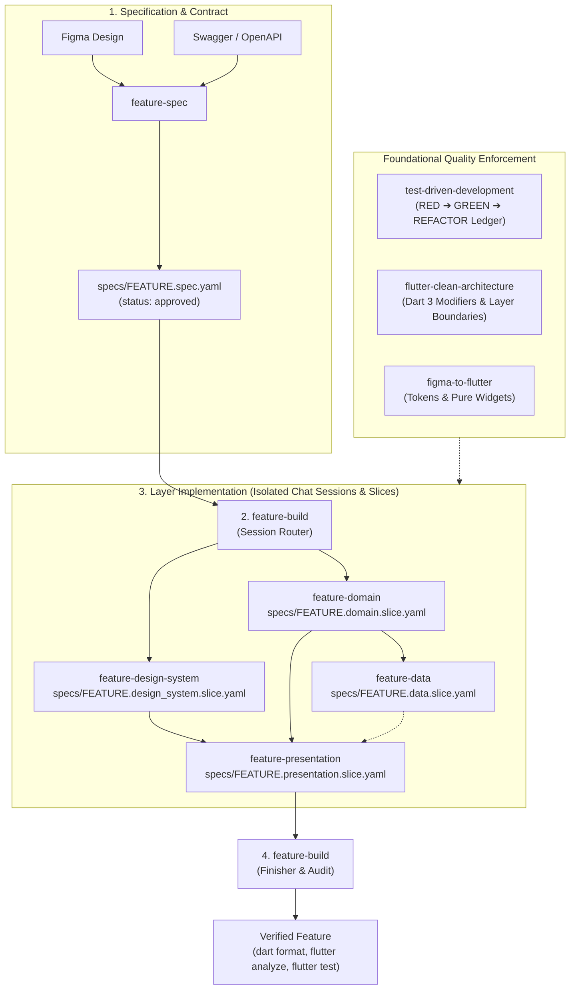

# Flutter Agent Skills 🚀

A comprehensive, production-grade suite of AI agent skills and team playbooks for Flutter development. Designed for **OpenMausBot**, **Claude Code**, **Cursor**, and **Google Antigravity / Gemini**.

These skills enforce strict Clean Architecture, design-token extraction, contract-first YAML specifications, test-driven development (TDD), and disciplined layer-by-layer implementation.

---

## 📦 What's Included

### Orchestration & Specification
| Skill | Directory | Purpose |
|---|---|---|
| **`feature-spec`** | [`skills/feature-spec/`](skills/feature-spec/SKILL.md) | Turns Figma designs and Swagger/OpenAPI endpoints into a single approved YAML contract (`specs/<feature>.spec.yaml`). |
| **`feature-build`** | [`skills/feature-build/`](skills/feature-build/SKILL.md) | Router and finisher for feature construction: directs sessions to isolated layer skills and performs final verification gates. |

### Layer Implementation (Isolated Sessions & Slices)
| Skill | Directory | Purpose |
|---|---|---|
| **`feature-design-system`** | [`skills/feature-design-system/`](skills/feature-design-system/SKILL.md) | Builds shared design tokens and pure widgets test-first against `specs/<feature>.design_system.slice.yaml`. |
| **`feature-domain`** | [`skills/feature-domain/`](skills/feature-domain/SKILL.md) | Builds domain entities, repository contracts, and use cases test-first against Fakes (`specs/<feature>.domain.slice.yaml`). |
| **`feature-data`** | [`skills/feature-data/`](skills/feature-data/SKILL.md) | Builds DTOs (`json_serializable`), data sources, and repository implementations test-first against Fakes (`specs/<feature>.data.slice.yaml`). |
| **`feature-presentation`** | [`skills/feature-presentation/`](skills/feature-presentation/SKILL.md) | Builds sealed BLoC/Cubit state holders, views, and page wiring test-first against Fakes (`specs/<feature>.presentation.slice.yaml`). |

### Foundations & Quality Enforcement
| Skill | Directory | Purpose |
|---|---|---|
| **`flutter-clean-architecture`** | [`skills/flutter-clean-architecture/`](skills/flutter-clean-architecture/SKILL.md) | Enforces feature-first Clean Architecture, Dart 3 class modifiers (`abstract interface class`, `final class`), sealed states, and functional error handling. |
| **`figma-to-flutter`** | [`skills/figma-to-flutter/`](skills/figma-to-flutter/SKILL.md) | Extracts design tokens into `lib/design_system/` and generates pure, reusable widgets decoupled from state management. |
| **`test-driven-development`** | [`skills/test-driven-development/`](skills/test-driven-development/SKILL.md) | Enforces the iron law of TDD: **Red-Green-Refactor** ledger (`red_output`, `green_output`, `refactor_note`), non-throwing stubs, and hand-written Fakes. |

---

## 🤖 Importing into OpenMausBot

OpenMausBot supports two flexible ways to import these capabilities:

### Method 1: 1-Click Team Import (Recommended)

Import the entire **Flutter Engineering Squad** (Chief of Staff, Flutter Architect, Flutter Builder, and TDD Specialist) with all 9 skills pre-wired:

1. Open **OpenMausBot**.
2. Navigate to **Teams → Import** (or click the **+** button in the team list).
3. Choose one of the following:
   - **Paste GitHub URL**:
     ```text
     https://raw.githubusercontent.com/mahmood1996/flutter-skills/main/playbooks/flutter-engineering-team.md
     ```
   - **Import File from Disk**: Select `playbooks/flutter-engineering-team.md` from your cloned repository.
4. Review the team summary card and click **Import Team**.
5. Enable the skills under each bot's **Skills** tab when you're ready to start building!

---

### Method 2: Individual Skill Import

To attach specific skills to any existing bot in OpenMausBot:

1. In OpenMausBot, open **Settings → Import** (or navigate to a bot's settings and click **Skills**).
2. Click **Add Custom Skill** or **Import Folder**.
3. Select any skill directory (e.g. `skills/feature-domain/`) or paste the contents of its `SKILL.md`.
4. Save and toggle the skill **ON** for the bot.

---

## 🛠️ Usage with Other AI Coding Assistants

### Claude Code
Clone or copy the skills into your local Claude configuration:
```bash
# Workspace level
mkdir -p .claude/skills
cp -r skills/* .claude/skills/

# Or global user level
mkdir -p ~/.claude/skills
cp -r skills/* ~/.claude/skills/
```

### Cursor & Windsurf
Add the skills directly to your project root or rules:
- Copy the desired `SKILL.md` files into `.cursor/rules/` or your project prompt library.

### Antigravity / Gemini CLI
Copy into the agent customization skills root:
```bash
# Global
cp -r skills/* ~/.gemini/config/skills/

# Workspace
mkdir -p .agents/skills
cp -r skills/* .agents/skills/
```

---

## 🔄 End-to-End Workflow



1. **Plan & Spec (`feature-spec`)**: Normalize Figma designs and Swagger/OpenAPI definitions into a single, approved YAML contract (`specs/<feature>.spec.yaml`).
2. **Route Implementation (`feature-build`)**: Read the approved spec's `build:` block and direct execution to the next layer skill in a dedicated, fresh chat session:
   - `design_system` ➔ `feature-design-system`
   - `domain` ➔ `feature-domain`
   - `data` ➔ `feature-data` (requires `domain` done)
   - `presentation` ➔ `feature-presentation` (requires `domain` and `design_system` done or skipped)
3. **Execute Layer Sessions with Slices**: Each layer creates its own slice file (`specs/<feature>.<layer>.slice.yaml`) as an immutable ledger. Scenarios move strictly `pending -> red -> green -> refactored`, recording exact failing (`red_output`) and passing (`green_output`) lines with hand-written Fakes in `test/fakes/`.
4. **Enforce Architectural Foundations**:
   - `flutter-clean-architecture`: Enforce Dart 3 class modifiers (`abstract interface class` contracts, `final class` implementations), sealed BLoC states/events, and `Either<Failure, T>` pipelines.
   - `figma-to-flutter`: Guarantee all colors, spacing, radii, and fonts consume `lib/design_system/` tokens, and widgets remain pure with no state management leakage.
   - `test-driven-development`: Never write production code before a failing test assertion, never skip a status, and never use mock packages.
5. **Finish & Audit (`feature-build`)**: Once all layers are `done`, run `dart format .`, `flutter analyze`, the full `flutter test` suite, the design system dependency check, and compile the final report from all slice ledgers.

---

## 📄 License

This repository is licensed under the [MIT License](LICENSE).

